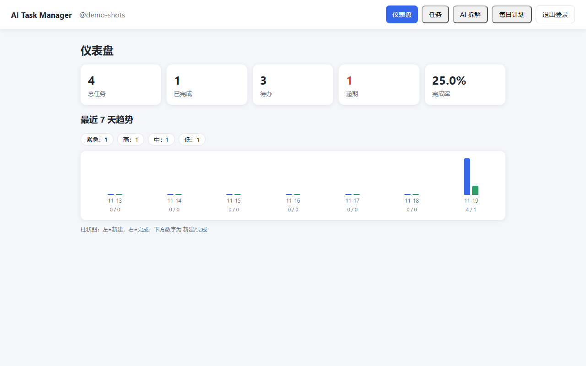
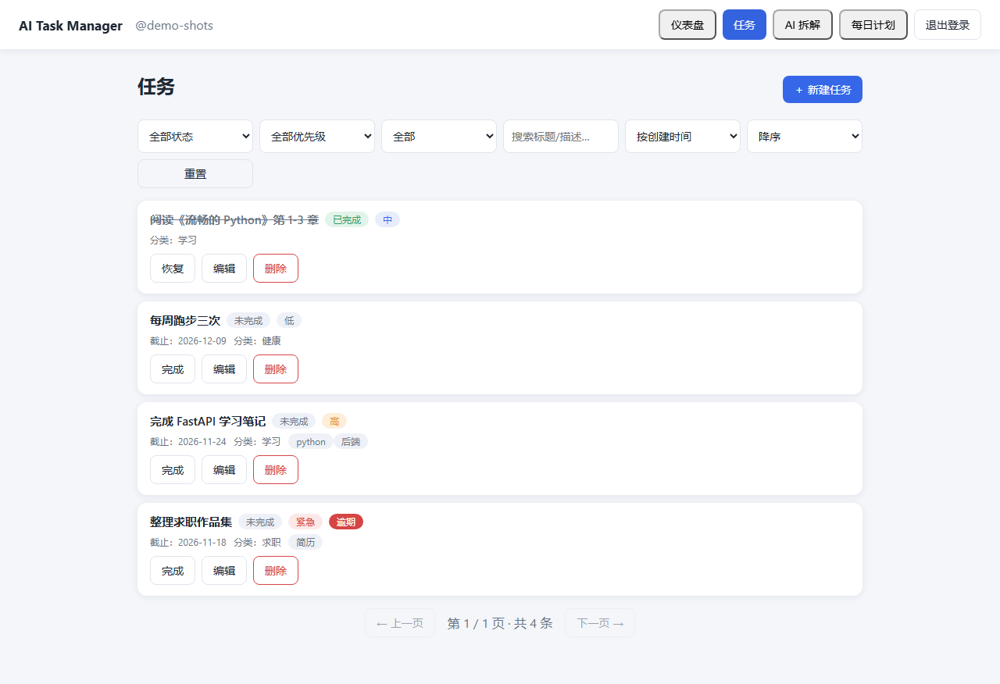
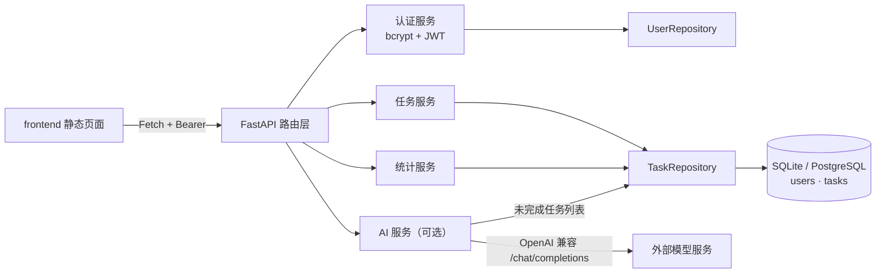

# AI Task Manager（ai-task-manager）


面向个人用户的 **AI 智能任务管理系统**：JWT 认证、任务 CRUD 与多维筛选、真实数据库统计，
以及可选的 **AI 任务拆解**与 **AI 每日计划**（OpenAI 兼容接口；未配置 AI 时普通功能完整可用）。

| 仪表盘 | 任务列表 |
| --- | --- |
|  |  |

## 功能特性

- **用户认证**：注册 / 登录 / 当前用户（JWT）；bcrypt 密码哈希；用户数据完全隔离；
- **任务管理**：创建/查看/编辑/删除/完成/恢复；状态、优先级、分类、标签、截止日期；
- **多维查询**：状态/优先级/分类筛选、关键词搜索（LIKE 转义）、逾期识别、截止日期区间、分页与 5 种排序；
- **真实统计**：总量/完成/待办/逾期/完成率/优先级分布/近 7 天新建与完成趋势（全部来自 SQL 聚合）；
- **AI 任务拆解**：目标 → 结构化子任务预览 → 用户修改确认 → 批量入库（相对天数换算日期，防模型编造）；
- **AI 每日计划**：基于真实未完成任务排期，只接受真实任务 id，逾期提醒由服务端计算；
- **原生前端**：登录/仪表盘/任务/AI 四个视图，加载态、空态、错误与成功提示、响应式布局。

明确不做（保持定位清晰）：多用户协作、日历视图、邮件提醒。

## 技术栈

Python 3.11+（3.14 实测）· FastAPI · Pydantic v2 · SQLAlchemy 2.x · Alembic · SQLite（默认）/ PostgreSQL（可选）
· PyJWT · bcrypt · httpx · Pytest · Ruff · Docker · GitHub Actions · 原生 HTML/CSS/JS 前端

## 架构



## 项目目录

```text
app/
├── api/          路由与依赖注入（auth / tasks / statistics / health / ai）
├── core/         配置、安全（bcrypt+JWT）、错误体系、日志、异常处理
├── database/     引擎/会话、Alembic 迁移执行
├── models/       ORM：User / Task
├── schemas/      Pydantic 请求/响应模型
├── repositories/ 数据访问（过滤/排序/分页/聚合）
├── services/     业务服务（认证/任务/统计/AI）
└── main.py       应用工厂（启动即执行迁移，幂等）
alembic/          迁移脚本
frontend/         原生前端
tests/            53 项测试（临时隔离数据库，绝不调用真实付费 API）
scripts/          可选开发脚本（Playwright 截图）
```

## 环境要求

- **Python 3.11**（基础兼容版本）或 **3.14**（最新实测版）；两者均已通过全部测试
- Docker（可选，用于容器化部署；本仓库 Docker 配置在无 Docker 环境下编写，未实测容器构建）

## 安装

```bash
py -3.14 -m venv .venv          # 或 py -3.11 -m venv .venv；本机 Git Bash 的 python 是 MSYS2 版，用 py 启动器
source .venv/Scripts/activate   # PowerShell: .venv\Scripts\Activate.ps1
python -m pip install -e ".[dev]"
```

## 环境变量

复制 `.env.example` 为 `.env` 按需修改；不配置任何 AI 变量也能完整运行。

| 变量 | 默认 | 说明 |
| --- | --- | --- |
| `ENVIRONMENT` | `development` | `production` 时强制要求 `SECRET_KEY`（≥32 字符） |
| `SECRET_KEY` | 自动随机 | JWT 签名密钥；留空则重启后登录态失效 |
| `JWT_EXPIRE_MINUTES` | `1440` | 访问令牌有效期（分钟） |
| `DATABASE_URL` | `sqlite:///data/app.db` | 可选 PostgreSQL 连接串 |
| `AI_BASE_URL` / `AI_API_KEY` / `AI_MODEL` | 空 | OpenAI 兼容接口；三项齐全才启用 AI 功能 |
| `AI_TIMEOUT_SECONDS` | `30` | AI 请求超时 |

## 数据库迁移

- 启动时自动执行 `alembic upgrade head`（幂等，绝不删除数据）；
- 手动执行：`alembic upgrade head`；模型变更后：`alembic revision --autogenerate -m "..."`；
- 指定目标库：`alembic -x db_url=sqlite:///path/to/app.db upgrade head`。

## 启动

```bash
python -m uvicorn app.main:app --host 127.0.0.1 --port 8000
# 开发热重载：python -m uvicorn app.main:app --reload
```

- 前端：<http://127.0.0.1:8000/>（注册 → 登录 → 使用）
- API 文档：<http://127.0.0.1:8000/docs>

## Docker 启动

```bash
# 1) 在 .env 中设置 SECRET_KEY（≥32 字符随机串）
# 2) 构建并启动（数据持久化在宿主机 ./data）
docker compose up -d
docker compose logs -f
```

> 说明：本项目 Docker 配置在未安装 Docker 的机器上编写，**容器构建未经实测**；本机验证方式为
> "安装依赖 → 迁移 → 测试 → 健康冒烟"（与镜像内步骤一致）。

## 测试

```bash
python -m pytest -q     # 53 项：认证/任务/统计/迁移/AI（临时隔离库 + MockTransport）
ruff check .
```

## API 使用示例（curl）

```bash
# 注册 + 登录
curl -X POST http://127.0.0.1:8000/api/auth/register \
  -H "Content-Type: application/json" \
  -d '{"username":"alice","password":"password123"}'
TOKEN=$(curl -s -X POST http://127.0.0.1:8000/api/auth/login \
  -H "Content-Type: application/json" \
  -d '{"username":"alice","password":"password123"}' | python -c "import sys,json;print(json.load(sys.stdin)['access_token'])")

# 创建任务 / 列表 / 统计
curl -X POST http://127.0.0.1:8000/api/tasks -H "Authorization: Bearer $TOKEN" \
  -H "Content-Type: application/json" -d '{"title":"准备面试","priority":"high","due_date":"2026-12-01"}'
curl "http://127.0.0.1:8000/api/tasks?status=todo&sort_by=priority" -H "Authorization: Bearer $TOKEN"
curl http://127.0.0.1:8000/api/statistics -H "Authorization: Bearer $TOKEN"

# AI（需先配置环境变量）
curl -X POST http://127.0.0.1:8000/api/ai/breakdown -H "Authorization: Bearer $TOKEN" \
  -H "Content-Type: application/json" -d '{"goal":"准备一个月后的 Python 后端实习面试"}'
```

全部接口见 `/docs`。AI 拆解的响应**只返回预览**；确认保存走
`POST /api/ai/breakdown/confirm`（前端已实现预览→修改→确认流程）。

## AI 功能配置

- 兼容任何 OpenAI 兼容服务；以智谱 GLM 为例：`AI_BASE_URL=https://open.bigmodel.cn/api/paas/v4`、
  `AI_MODEL` 取官方模型列表（官方示例中出现 `glm-4-flash` / `glm-5.3`）；
- `AI_API_KEY` 只填在本地 `.env`，**绝不提交、绝不发给别人**；
- 模型输出由服务端做 JSON 提取 + Pydantic 校验；格式无法解析返回 502 `ai_response_error`；
  超时返回 504；额度不足返回 502 `ai_quota`；
- 未配置时：`POST /api/ai/*` 返回 400 `ai_not_configured` 与明确提示，其余功能不受影响。

## 常见问题

- **登录态重启后失效？** 未设置 `SECRET_KEY` 时每次启动随机生成密钥，属预期行为；生产请设置固定值。
- **数据库文件在哪？** 默认 `data/app.db`（SQLite），`data/` 整体被 `.gitignore` 排除。
- **如何换 PostgreSQL？** 安装 `psycopg`（可加入依赖），设置 `DATABASE_URL=postgresql+psycopg://...`，再执行 `alembic upgrade head`。
- **AI 返回格式错误？** 模型偶发不遵守 JSON 约定，重试即可；服务端已做解析失败的用户提示，不会污染任务数据。

## 当前安全限制

- 有 JWT 认证与用户隔离，但**没有刷新令牌、没有管理员/多租户**；
- 无验证码与登录频率限制——公网部署需自行加防护（如反向代理限流）；
- AI Prompt 中包含用户输入文本：已做输出校验与 id 白名单过滤，但请勿在共享环境启用 AI 功能而不加审查。

## 后续改进方向

1. 刷新令牌与令牌吊销；
2. PostgreSQL 生产部署验证与 Docker 镜像实测；
3. 全文检索式任务搜索与任务提醒推送；
4. AI 输出的回归测试集。

## 版本说明

- v0.1（当前）：认证 + 任务 CRUD/统计 + 可选 AI（拆解/每日计划）+ 前端 + 迁移体系。

## 开发约定

遵循工作区 `docs/project-standards.md`；提交与发布安全流程见 `docs/git-and-release-checklist.md`。
